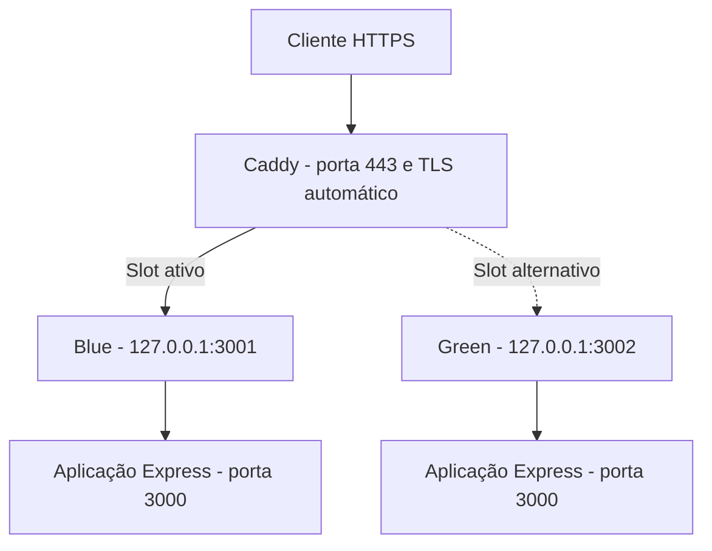

Infraestrutura como código e pipeline de CI/CD para uma API de demonstração em **Node.js/Express**, executada em dois ambientes na AWS: **staging** e **production**.

A solução utiliza **Terraform**, **Docker**, **Amazon ECR**, **GitHub Actions**, **AWS Systems Manager (SSM)** e **Caddy**. As aplicações são publicadas por **HTTPS**, com deploy **blue-green**, validação de saúde e **rollback manual** por ambiente.

## 1. Aplicação

A API implementa um endpoint de verificação de saúde:

```http
GET /status
```

Com a variável `APP_ENV=staging`, por exemplo, a resposta esperada é `HTTP 200`:

```json
{
  "environment": "staging",
  "status": "ok"
}
```

O valor de `environment` vem de `APP_ENV`. Quando essa variável não está definida, o campo pode ser omitido no JSON.

A aplicação escuta na porta **3000 dentro do container**. Nas EC2, cada container publica essa porta apenas no loopback (`127.0.0.1:3001` ou `127.0.0.1:3002`); o acesso externo é feito pelo **Caddy na porta 443/HTTPS**.

### Executar localmente

Requisito: Docker instalado.

```bash
docker build -t lacrei-api:local .
docker run -d --name lacrei-local -p 127.0.0.1:3000:3000 -e APP_ENV=local lacrei-api:local
curl --fail http://127.0.0.1:3000/status
docker rm -f lacrei-local
```

O `Dockerfile` parte de `node:22-alpine`, instala dependências de execução, roda o processo com **`USER node`** (sem privilégios de root) e define um `HEALTHCHECK` que consulta `/status`.

### Testes automatizados

Os testes usam **Jest + Supertest** e são executados com:

```bash
npm ci
npm test
```

Os seis casos atualmente implementados em `tests/index.test.js` verificam: retorno HTTP 200, JSON com `status: "ok"`, identificação dos ambientes `staging` e `production`, resposta 404 para uma rota inexistente e rejeição de `POST /status` (404).

São testes HTTP da aplicação Express, sem levantar uma EC2. O pipeline também executa um teste do container Docker e seu health check.

## 2. Arquitetura

### Fluxo de entrega


O CD também pode ser disparado manualmente para uma tag de imagem já publicada. O rollback tem um **workflow separado**, com seleção do ambiente.

### Estrutura de cada ambiente



O Caddy aponta para **um slot por vez**. O novo container é iniciado e validado na porta inativa; somente depois a configuração do proxy é alterada. O container anterior permanece disponível para rollback.

| Componente | Responsabilidade |
| --- | --- |
| Terraform | Provisionar EC2, rede, IAM, ECR, logs, métricas, alarmes e SNS |
| EC2 `staging` e `production` | Hospedar Docker e Caddy em instâncias independentes (`t2.micro`) |
| Amazon ECR (`lacrei-api`) | Armazenar imagens identificadas pelo SHA, com tags imutáveis e `scan_on_push` |
| GitHub Actions CI | Executar testes, construir/testar a imagem e publicá-la no ECR |
| GitHub Actions CD | Implantar a mesma imagem em staging e depois production |
| GitHub Actions Rollback | Alternar manualmente para o slot anterior de um ambiente escolhido |
| OIDC + IAM | Autenticar os workflows na AWS sem access keys permanentes |
| AWS SSM | Executar scripts nas instâncias sem expor acesso SSH |
| Caddy | Receber HTTPS, gerenciar certificados TLS e encaminhar o tráfego ao slot ativo |
| CloudWatch | Receber logs da aplicação, apresentar métricas e avaliar alarmes |
| SNS | Enviar alertas de infraestrutura por e-mail |


## 3. Ambientes e provisionamento

### Endereços públicos

| Ambiente | Endpoint |
| --- | --- |
| Staging | [https://pedro-lacrei-staging.duckdns.org/status](https://pedro-lacrei-staging.duckdns.org/status) |
| Production | [https://pedro-lacrei-production.duckdns.org/status](https://pedro-lacrei-production.duckdns.org/status) |

Os subdomínios são administrados pelo **DuckDNS**. O Caddy gerencia automaticamente os certificados TLS. A configuração DNS depende dos IPs públicos atuais das EC2.

### Pré-requisitos

- Conta AWS com permissões para provisionar os recursos;
- AWS CLI e Terraform configurados (Terraform `>= 1.2`, provider AWS `~> 5.92`);
- Repositório com GitHub Actions habilitado;
- VPC padrão e subnets padrão disponíveis em `us-east-1`;
- Domínios DuckDNS configurados para apontar para as respectivas EC2.
### Criar ou atualizar a infraestrutura

A partir da raiz do repositório:

```bash
cd infra
terraform init
export TF_VAR_alert_email="seu-email@exemplo.com"
terraform plan
terraform apply
```

Caso utilize um perfil nomeado do AWS CLI, defina `AWS_PROFILE` antes desses comandos.

Os arquivos Terraform provisionam, entre outros recursos:

- Duas EC2 Ubuntu 24.04 `t2.micro`, identificadas pelas tags `Name=staging` e `Name=production`;
- Security Group com entrada pública **TCP/443** e saída permitida;
- Repositório ECR com tags imutáveis e varredura no envio de imagens;
- IAM Roles para EC2 e GitHub Actions;
- CloudWatch Log Groups `/lacrei/staging` e `/lacrei/production`, dashboard e alarmes;
- Tópico SNS e assinatura de e-mail para alertas de infraestrutura.

O arquivo `infra/user_data.sh` instala Docker, AWS CLI v2, SSM Agent e Caddy.

### Validar o serviço

Depois que os registros DuckDNS apontarem para as instâncias corretas e a aplicação tiver sido implantada:

```bash
curl --fail https://pedro-lacrei-staging.duckdns.org/status
curl --fail https://pedro-lacrei-production.duckdns.org/status
```

As respostas devem apresentar `status: "ok"` e o nome do ambiente correspondente.

## 4. CI/CD

### CI — `.github/workflows/ci.yml`

O CI é executado em *pull requests* e *pushes* para `master`:

1. Faz checkout do repositório, executa `npm ci` e `npm test` (Jest);
2. Constrói a imagem Docker;
3. Inicializa o container no runner, aguarda o `HEALTHCHECK` e consulta `/status`;
4. **Somente após um push na `master` com testes aprovados**, autentica na AWS por OIDC e publica a imagem no ECR com a tag correspondente a `github.sha`.

O ECR não permite sobrescrever tags existentes, facilitando a rastreabilidade das versões.

### Autenticação com GitHub Actions OIDC

Os workflows usam `aws-actions/configure-aws-credentials@v4` com `role-to-assume` para obter **credenciais temporárias** por OIDC. A trust policy da role está vinculada ao repositório e à branch `master`.

### CD — `.github/workflows/cd.yml`

O CD inicia automaticamente depois de um CI bem-sucedido decorrente de push na `master`. Também aceita execução manual pelo GitHub Actions, opcionalmente informando uma `image_tag` já disponível no ECR.

1. Autentica na AWS via OIDC;
2. Localiza as instâncias por tag (`Name=staging` e `Name=production`), evitando IDs fixos;
3. Aguarda cada instância ficar **Online** no SSM;
4. Envia `deploy.sh` pelo SSM Run Command e acompanha o resultado;
5. Conclui **staging antes de iniciar production**; se a primeira etapa falhar, a segunda não começa.

O workflow utiliza a mesma tag de imagem para staging e production.

### Blue-green — `.github/workflows/deploy.sh`

O script obtém a imagem no ECR e identifica o slot ativo lendo `/etc/caddy/Caddyfile`:

| Slot | Container | Porta na EC2 |
| --- | --- | --- |
| Blue | `lacrei-api-blue` | `127.0.0.1:3001` |
| Green | `lacrei-api-green` | `127.0.0.1:3002` |

**Primeiro deploy:** em uma EC2 sem nenhum dos dois containers, o script cria o Blue na porta 3001, espera o estado `healthy` e testa a aplicação. Não há slot anterior disponível para rollback nesse momento.

**Deploys seguintes:** o script mantém o slot ativo atendendo, remove/recria o container do slot inativo com a nova imagem, consulta o health check e faz uma requisição HTTP direta à porta do novo container. Somente após a validação altera o upstream do Caddy, recarrega o serviço e verifica o endpoint HTTPS.

- Uma falha **antes da troca de tráfego** impede a promoção do novo container;
- Se ocorrer falha durante a troca ou sua validação, o script **tenta restaurar o Caddyfile anterior**.

As verificações de saúde avaliam disponibilidade, mas **não conferem explicitamente se o endpoint HTTPS retornou o SHA esperado**.

## 5. Rollback

### Rollback manual do slot — `.github/workflows/rollback.yml`

1. Abra **GitHub → Actions → Rollback → Run workflow**;
2. Selecione `staging` ou `production` no campo `environment`;
3. Execute o workflow;
4. Confirme que o endpoint HTTPS do ambiente continua respondendo.

O `rollback.sh` identifica a porta ativa no Caddyfile, verifica se o **outro container** existe, está `healthy` e responde diretamente em `/status`. Se estiver apto, altera o upstream do Caddy, recarrega o serviço e valida o domínio HTTPS. Se a validação após a troca falhar, **tenta restaurar a configuração anterior**.

**Esse rollback alterna entre dois containers existentes: não reconstrói imagens e não mantém um histórico completo de versões.** Após a recriação da EC2 e seu primeiro deploy, ainda não há um segundo slot para retornar. Executar rollback duas vezes, com ambos os containers saudáveis, pode alternar de volta ao ponto de partida.

### Reimplantar uma versão específica

Caso uma versão antiga não esteja mais presente em nenhum slot, é possível executar manualmente **Actions → CD → Run workflow**, informando em `image_tag` o SHA de uma imagem ainda existente no ECR. Isso realiza um novo deploy da imagem escolhida (staging e depois production); é diferente do rollback instantâneo por troca de slot.

## 6. Observabilidade e alertas

### Logs da aplicação

Os containers utilizam o driver de logging **`awslogs`**, enviando stdout/stderr para:


| Ambiente | CloudWatch Log Group | Retenção Terraform |
| --- | --- | --- |
| Staging | `/lacrei/staging` | 7 dias |
| Production | `/lacrei/production` | 30 dias |

### Métricas e alarmes

O dashboard CloudWatch **`lacrei-api`** apresenta CPU e status checks das duas EC2.


Há dois alarmes por ambiente:

- **CPU alta:** média de CPU ≥ 80% em dois períodos de 5 minutos;
- **Falha de status da EC2:** valor ≥ 1 em dois períodos de 5 minutos.
  
Ambos têm `alarm_actions` associado ao tópico SNS **`lacrei-alerts`**, com assinatura por e-mail configurada no Terraform (`alert_email`).


## 7. Segurança

| Controle ou decisão | Situação atual |
| --- | --- |
| Credenciais AWS nos workflows | **OIDC** com credenciais temporárias; sem access keys permanentes |
| Credenciais das EC2 | IAM Role / instance profile |
| Permissões de deploy | Políticas IAM para ECR, descoberta das EC2, SSM e notificações |
| Execução da API | Container executa com `USER node`, sem root |
| Armazenamento de imagens | ECR com tags imutáveis e `scan_on_push` |
| Acesso administrativo às EC2 | SSM Run Command; nenhuma regra SSH é declarada no Security Group |
| Tráfego externo da API | HTTPS no Caddy pela porta 443 |
| Containers Blue/Green | Portas 3001/3002 publicadas somente em `127.0.0.1` |
| Rollback | Manual, por ambiente, com validação do slot de destino |


## 8. Decisões técnicas e aprendizados

| Desafio | Solução adotada | Justificativa |
| --- | --- | --- |
| Reconstrução de EC2 altera IDs | Buscar instâncias por tags de ambiente | Evitar referências fixas nos workflows |
| Execução remota sem SSH | SSM Run Command | Reduzir portas expostas e centralizar a execução |
| Credenciais permanentes no GitHub | Substituição por OIDC e IAM Role | Usar credenciais temporárias |
| Identificar exatamente uma imagem | Tag SHA no ECR, com imutabilidade | Rastreabilidade e redeploy de versões |
| Garantir sequência de implantação | Staging antes de production | Não avançar quando staging falhar |
| Reduzir risco de troca de versão | Blue-green com Caddy e health checks | Validar um slot antes de promovê-lo |
| Retornar rapidamente à versão anterior | Workflow de rollback por ambiente | Trocar o upstream do proxy sem novo build |
| Diagnosticar problemas | CloudWatch, saída do SSM e verificações de saúde | Aumentar a observabilidade da aplicação e dos deploys |

## 9. Registro de problemas e correções

| Problema encontrado | Correção aplicada |
| --- | --- |
| O CD não era acionado depois do CI | Correção do nome do workflow em `workflow_run` e inclusão de disparo manual |
| `aws` ou `docker` indisponíveis em instâncias novas | Instalação por `user_data.sh`, com AWS CLI v2 pelo instalador oficial |
| API ainda não respondia durante a inicialização | Espera pelo Docker HEALTHCHECK e requisição direta ao container |
| Uma EC2 nova não tinha slot anterior de deploy | Implementação do bootstrap do Blue na porta 3001 |
| Deploys inicialmente não tinham HTTPS | Configuração do Caddy por ambiente com certificados TLS automáticos |
| Verificação de saúde pela URL pública antes da troca de slot | Verificação direta em `127.0.0.1:3001/3002`, mantendo HTTPS para a validação posterior ao Caddy |

---

**Resumo:** o projeto demonstra um fluxo de entrega reproduzível para uma API simples, com testes em CI, autenticação federada por OIDC, deploy sequencial em dois ambientes, estratégia blue-green, rollback manual, HTTPS e recursos de observabilidade.
